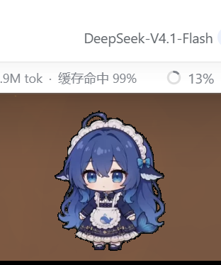
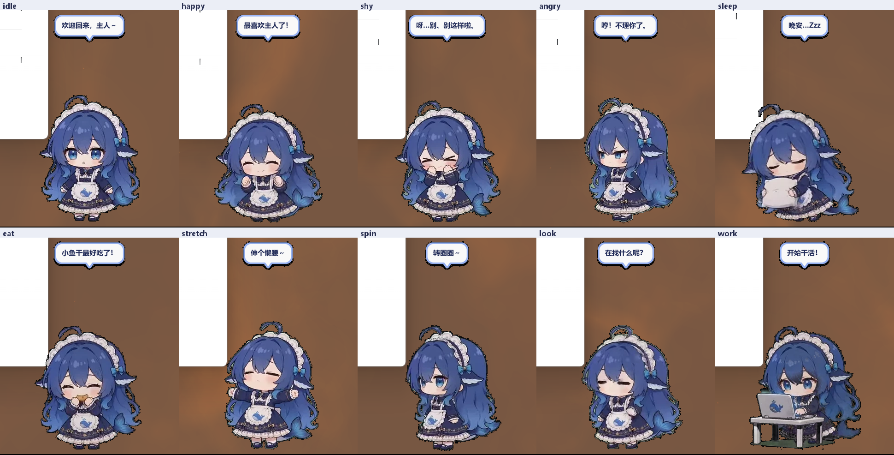

# 小鲸鱼娘 · DeepSeek 桌宠

一只住在 Windows 桌面上的蓝发鲸鱼女仆。透明无边框、始终置顶，会呼吸、眨眼、东张西望、打哈欠、
睡觉、哼歌、转圈、敲键盘；点她摸摸头，双击直接唤起本机的 DeepSeek Harness。





## 下载

到 [Releases](../../releases) 页面下载最新版：

| 文件 | 说明 |
| --- | --- |
| `XiaoJingNiang-Setup-v1.0.0.exe` | 小鲸鱼娘安装包，双击即装（约 66 MB） |
| `Source code` | 对应版本的源码 |

系统要求：**Windows 10 / 11 64 位**。不需要安装 Python，不需要联网。

## 安装 / 卸载

1. 双击 `小鲸鱼娘-安装程序.exe`，点「是」
2. 自动装到 `%LOCALAPPDATA%\XiaoJingNiang`，创建桌面快捷方式与开机自启
3. 装完自动启动

卸载：开始菜单 →「小鲸鱼娘」→「卸载小鲸鱼娘」。
存档在 `%APPDATA%\DeepSeekPet\state.json`，卸载不会删除。

> 程序未做数字签名，部分杀毒软件可能提示风险，属 PyInstaller 打包程序的常见误报，选择「允许运行」即可。

## 玩法

| 操作 | 效果 |
| --- | --- |
| **双击** | 打开本机 DeepSeek Harness；已在运行则切到前台（最小化也会还原） |
| **单击** | 摸摸头：随机「开心 / 害羞 / 生气 / 敲桌子」 |
| **拖拽** | 拎到桌面任意位置，松手就停在那儿，不会掉下去 |
| **右键** | 打开 DeepSeek、喂小鱼干、喝奶茶、转圈、唱歌、工作、睡觉、伸懒腰、置顶、开机自启、退出 |

她还会自己找乐子：每 15～35 秒随机做个小动作，偶尔自言自语；饿肚子时表情会变。
饱食度 / 心情 / 亲密度 / 陪伴时长都会存档。

## 动作与表情

23 组逐帧动画：待机呼吸、东张西望、开心跃动、害羞、傲娇生气、受惊炸毛、打喷嚏、哈欠、犯困、
睡觉、睡眼惺忪、吃小鱼干、喝奶茶、伸懒腰、女仆礼仪、哼歌、漂浮踏步、360° 转圈、被拖拽悬空、
认真工作（带笔记本）、敲桌子、跳起、甩尾巴。

## 从源码运行

```powershell
pip install pillow
python src/pet.py
```

需要 Python 3.9+。生成/重建动画帧包：

```powershell
# 从 dsh-whale-girl-pet 的 webm 重新抽取裁切
python src/build_anims.py
```

打包成 exe（需要 `pip install pyinstaller`）：

```powershell
cd src
pyinstaller --noconfirm --windowed --name 小鲸鱼娘 --icon assets/pet.ico --add-data "assets;assets" pet.py
```

## 技术实现

- **透明窗口**：Tk + `-transparentcolor` 色键，无边框、置顶、透明区域鼠标穿透
- **动画**：素材 webm 逐帧解码 → 裁切 → 逐帧 WebP 打包进单个 `.bin`，运行时按需解码 + LRU 缓存
- **DPI**：进程 DPI 感知，150% 缩放下按物理像素渲染
- **交互**：窗口内自绘气泡、拖拽物理、随机行为状态机

## 素材与许可

- 代码：MIT，见 [LICENSE](LICENSE)
- 角色动画素材来自开源项目 **[dsh-whale-girl-pet](https://www.npmjs.com/package/dsh-whale-girl-pet)**（MIT License），
  本项目把其中的 webm 逐帧解码、裁切、重新打包为 WebP 帧包，并重写了 Windows 桌面端运行时。
  详见 [THIRD_PARTY.md](THIRD_PARTY.md)。

如果你要二次分发，请保留上述署名。

## 支持作者

如果这只小鲸鱼娘让你心情好了一点，可以请她喝杯奶茶：

<!-- 收款码放在 assets/donate-qr.png，替换占位即可 -->


（打赏完全自愿，不影响任何功能。）
